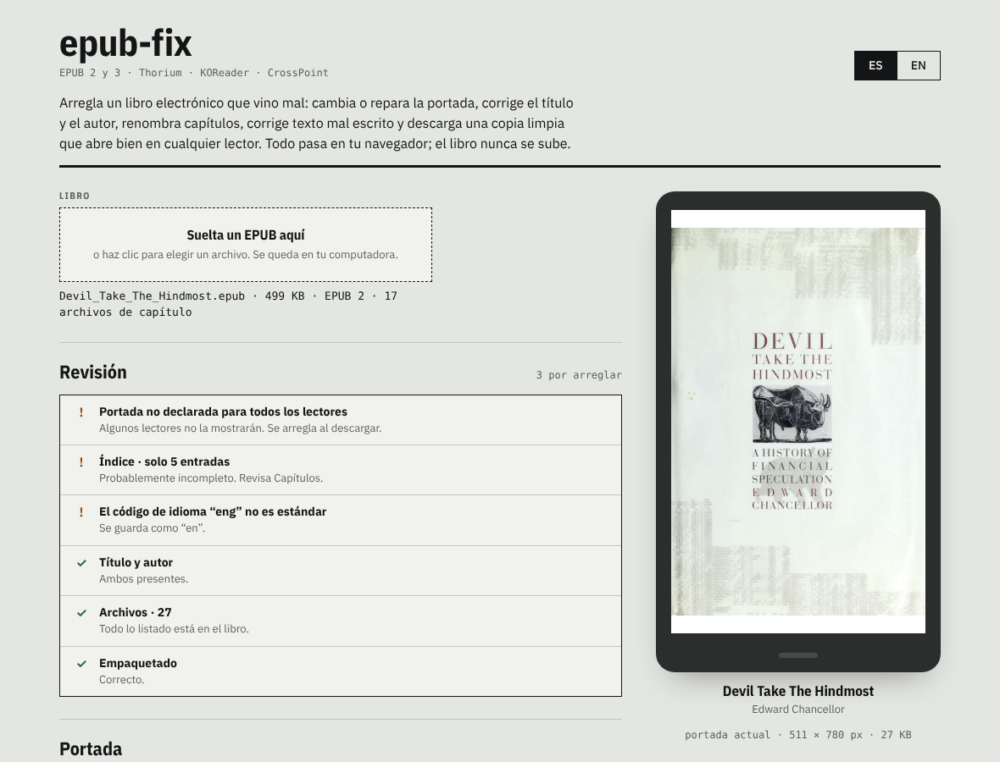

# epub-fix

Arregla un libro electrónico que vino mal: cambia o repara la portada, corrige el título y el autor, renombra capítulos, corrige texto mal escrito y descarga un EPUB limpio que abre bien en cualquier lector.

**Úsalo aquí: [aendom.github.io/epub-fix](https://aendom.github.io/epub-fix/)**

*[Read in English](README.md)*

## Qué hace

Sueltas un EPUB en la página. epub-fix revisa cómo está armado el libro, te muestra qué está mal y te deja arreglarlo. Al descargar recibes una copia nueva; tu archivo original nunca se modifica.

Todo funciona en tu navegador. El libro nunca se sube y no hay servidor, cuenta ni nada que instalar.

## Qué arregla

- **Portada.** Encuentra la portada aunque no esté declarada, la muestra en una pantalla del tamaño de un lector y te deja reemplazarla con cualquier JPG, PNG o WebP. La portada se declara de todas las formas en que los lectores la buscan (`cover-image` de EPUB 3, `<meta name="cover">` de EPUB 2, la guía y una página de portada), así los lectores la encuentran sin importar dónde la busquen.
- **Datos.** Título, autor y *ordenar como* (por ejemplo *Cortázar, Julio*), serie y número, editorial, fecha, idioma, ISBN, etiquetas y descripción. La serie se guarda al estilo Calibre, que usan KOReader y muchos lectores, y al estilo EPUB 3.
- **Capítulos.** Muestra el índice y te deja renombrar cualquier entrada. Si el libro no tiene índice, o tiene muy pocas entradas, puede crear uno desde los títulos de los capítulos.
- **Texto.** Buscar y reemplazar en todo el libro, con opciones de mayúsculas exactas, palabras completas y regex. Solo toca el texto, nunca el código.
- **Estructura.** Arregla el empaquetado (`mimetype` primero y sin comprimir), declara archivos que están dentro del libro pero no listados, quita entradas de archivos que faltan, normaliza los códigos de idioma (`eng` → `en`) y mantiene el identificador del índice igual al del libro.

## Formato de salida

- **EPUB 3 + EPUB 2 (recomendado):** un EPUB 3 válido que además conserva el índice EPUB 2 (`toc.ncx`) y la declaración de portada, así lo navegan lectores antiguos y nuevos. Los libros EPUB 2 se actualizan.
- **Mantener la versión original:** un libro EPUB 2 sigue siendo EPUB 2, con sus problemas arreglados.

Los archivos que genera epub-fix pasan [EPUBCheck](https://www.w3.org/publishing/epubcheck/), el validador oficial, cuando los capítulos en sí son válidos.

## Cómo usarlo

1. Suelta un EPUB en la página.
2. Lee la lista de **Revisión**. Lo marcado con `!` se arregla solo al descargar; lo marcado con `✕` necesita tu ayuda, por ejemplo agregar una portada.
3. Cambia lo que quieras en **Portada**, **Datos**, **Capítulos** y **Buscar y reemplazar**.
4. **Descargar EPUB arreglado**. El archivo se llama *Título - Autor.epub*.

## Límites

- No edita a mano el texto de los capítulos ni los estilos del libro; para corregir texto usa buscar y reemplazar.
- Una frase cortada por formato (mitad en cursiva, por ejemplo) no la encuentra la búsqueda.
- Los capítulos con código roto se saltan en la búsqueda, pero se conservan tal cual.

## Usarlo en tu computadora

Es un solo archivo HTML. Abre `index.html` en un navegador o sirve la carpeta con cualquier servidor estático. La primera vez necesita internet para cargar [JSZip](https://stuk.github.io/jszip/) desde cdnjs.

## Licencia

MIT. Fuentes: IBM Plex, bajo la SIL Open Font License (ver `fonts/`).
