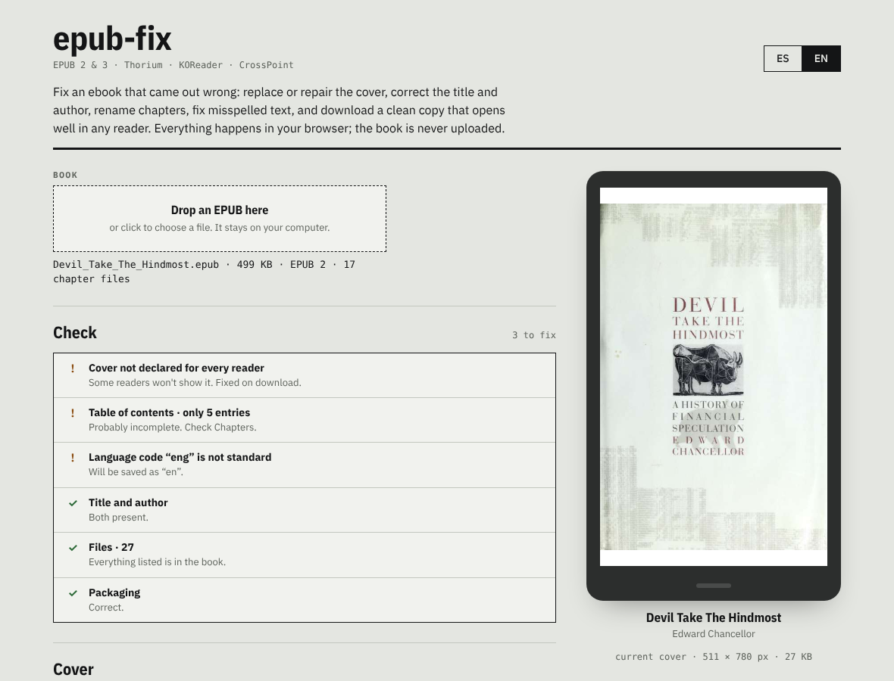

# epub-fix

Fix an ebook that came out wrong: replace or repair the cover, correct the title and author, rename chapters, fix misspelled text, and download a clean EPUB that opens well in any reader.

**Use it here: [aendom.github.io/epub-fix](https://aendom.github.io/epub-fix/)**

*[Leer en español](README.es.md)*

## What it does

You drop an EPUB on the page. epub-fix checks how the book is built, shows what's wrong, and lets you fix it. When you download, you get a new copy; your original file is never changed.

Everything runs in your browser. The book is never uploaded, and there is no server, no account and nothing to install.

## What it fixes

- **Cover.** Finds the cover even when it isn't declared, shows it on a reader-sized screen, and lets you replace it with any JPG, PNG or WebP. The cover is declared in every way readers look for it (EPUB 3 `cover-image`, the EPUB 2 `<meta name="cover">`, the guide and a cover page), so readers find it whichever way they look.
- **Details.** Title, author and *sort as* (for example *Cortázar, Julio*), series and number, publisher, date, language, ISBN, tags and description. Series are written both the Calibre way, which KOReader and many readers use, and the EPUB 3 way.
- **Chapters.** Shows the table of contents and lets you rename any entry. If the book has none, or only a few entries, it can build one from the chapter headings.
- **Text.** Find and replace across the whole book, with match case, whole words and regex options. It only touches the text, never the code around it.
- **Structure.** Fixes the packaging (`mimetype` first and uncompressed), declares files that are inside the book but not listed, drops entries for files that are missing, normalizes language codes (`eng` → `en`), and keeps the table of contents identifier in sync with the book.

## Output format

- **EPUB 3 + EPUB 2 (recommended):** a valid EPUB 3 that also keeps the EPUB 2 table of contents (`toc.ncx`) and cover declaration, so old and new readers both navigate it. EPUB 2 books are upgraded.
- **Keep the original version:** an EPUB 2 book stays EPUB 2, with its problems fixed.

Files produced by epub-fix pass [EPUBCheck](https://www.w3.org/publishing/epubcheck/), the official validator, when the chapters themselves are valid.

## How to use it

1. Drop an EPUB on the page.
2. Read the **Check** list. Items marked `!` are fixed automatically on download; items marked `✕` need you, for example adding a cover.
3. Change what you want in **Cover**, **Details**, **Chapters** and **Find and replace**.
4. **Download fixed EPUB**. The file is named *Title - Author.epub*.

## Limits

- It doesn't edit the chapter text by hand or the book's styles; use find and replace for text fixes.
- A phrase split by formatting (half in italics, for example) won't be found by the search.
- Chapters with broken code are skipped by the search, but are kept as they are.

## Run it locally

It's one HTML file. Open `index.html` in a browser, or serve the folder with any static server. It needs an internet connection the first time to load [JSZip](https://stuk.github.io/jszip/) from cdnjs.

## License

MIT. Fonts: IBM Plex, under the SIL Open Font License (see `fonts/`).
